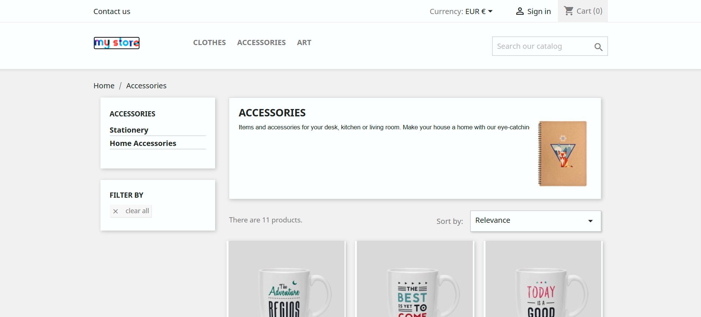
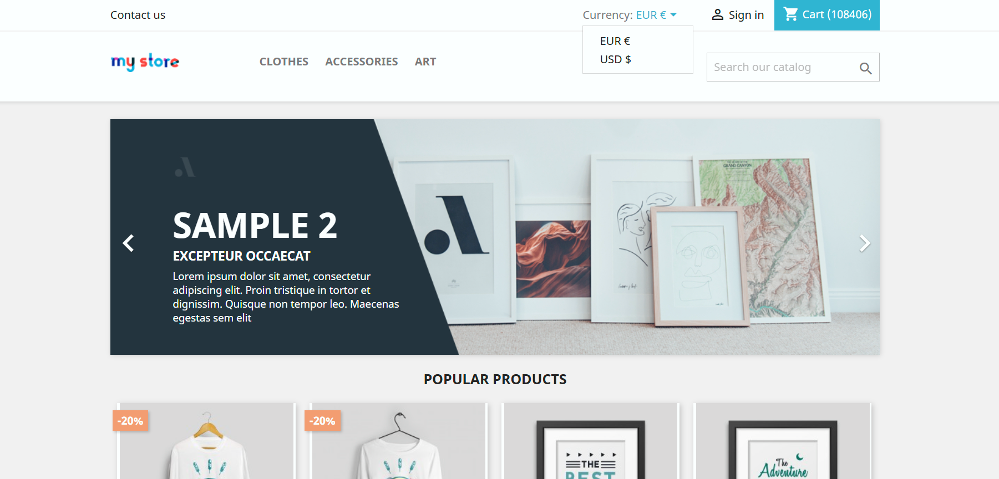
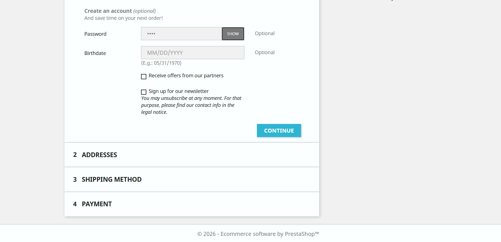

# 🐞 Bug Reports

## Overview
EXLORATORY TESTING

### 🐞 BUG 01: [HOMEPAGE] Nefunkční návrat na domovskou stránku přes logo.

#### Typ:
#### Severity:
#### Priority:
#### Enviroment:

#### Preconditions:
Uživatel je na domovské stránce eshopu MyStore.

#### Kroky k reprodukci:

1. Přejdeme na stránku jinou než domovská stránka (např. accessories).
2. Pro návrat na domovskou stránku klikneme na logo MyStore.

#### Očekávaný výsledek:

Po kliknutí na logo MyStore je uživatel přesměrován na domovskou stránku.

#### Skutečný výsledek:

Po kliknutí na logo MyStore nodejde k žádné reakci a uživatel zůstane na aktuální stránce.

#### Přílohy:

 

### 🐞 BUG 02: [DETAIL PRODUKTU] Nečitelný první řádek popisu produktu.

#### Typ:
#### Severity:
#### Priority:
#### Enviroment:

#### Preconditions:
Uživatel je na domovské stránce eshopu MyStore.

#### Kroky k reprodukci:

1. Na domovské stránce vybereme sekci Clothes.
2. Zvolíme sekci Men.
3. Vybereme produkt “Hummingbird printed t-shirt” a zobrazíme detail produktu.
4. Scrollujeme na description a zkontrolujeme text.

#### Očekávaný výsledek:

Celý text popisu produktu je zobrazen stejnou barvou a je čitelný.

#### Skutečný výsledek:

První řádek popisu produktu je zobrazen světlejší barvou než ostatní a je špatně čitelný.

#### Přílohy:

 

### 🐞 BUG 03: [VÝBĚR SEKCE] Nefunkční přesměrování na podkategorie v menu.

#### Typ:
#### Severity:
#### Priority:
#### Enviroment:

#### Preconditions:
Uživatel je na domovské stránce eshopu MyStore.

#### Kroky k reprodukci:

1. V menu vybereme položku (např. Clothes).
2. Klikneme na podkategorii (např. Men).

#### Očekávaný výsledek:

Po zvolení podkategorie (např. Men) se stránka přesměruje a zobrazí všechny produkty, které do této podkategorie spadají.

#### Skutečný výsledek:

Po zvolení podkategorie (např. Men) se stránka nepřesměruje, uživatel zůstane na aktuální stránce a  pouze se v URL přidá "#"

#### Přílohy:
.png)
 

### 🐞 BUG 04: [ZMĚNA MĚNY] Nefunguje změna měny z EUR na USD.

#### Typ:
#### Severity:
#### Priority:
#### Enviroment:

#### Preconditions:
Uživatel je na domovské stránce eshopu MyStore.

#### Kroky k reprodukci:

1. Na webu MyStore vpravo nahoře je možnost změna měny.
2. Kliknu na EUR a objeví se vyskakovací okno s možnostmi volby - EUR nebo USD.
3. Vybereme možnost USD.

#### Očekávaný výsledek:

Po změně měny se částky na celém webu zobrazí v amerických dolarech.

#### Skutečný výsledek:

Po kliknutí na možnost USD se částky nemění a zůstávají nadále v EUR. 

#### Přílohy:

 

### 🐞 BUG 05: [VYTVOŘENÍ ÚČTU] Tlačítko "Show" nezobrazí zadané heslo při vytváření účtu

#### Typ:
#### Severity:
#### Priority:
#### Enviroment:

#### Preconditions:
V košíku je minimálně 1 produkt a uživatel pokračuje tlačítkem “Proceed to checkout”. Vyplníme jméno, příjmení a email.

#### Kroky k reprodukci:

1. Pod formulářem pro vyplnění osobních údajů je možnost vytvoření uživatelského účtu.
2. Vyplníme heslo.
3. Klikneme na tlačítko “Show” pro ukázání hesla.

#### Očekávaný výsledek:

Po kliknutí na tlačítko “Show” se zobrazí heslo.

#### Skutečný výsledek:

Po kliknutí na tlačítko “Show” se heslo neobjeví, je stále skryté.

#### Přílohy:

